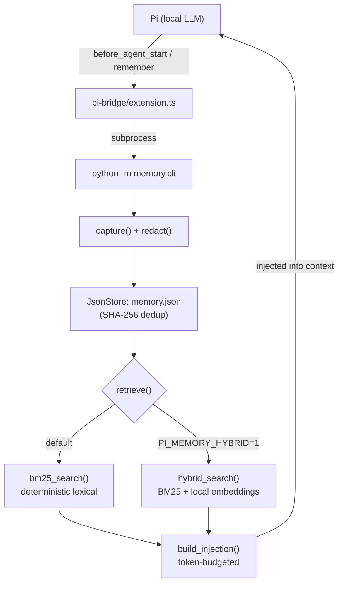

# Pi Memory — Cross-Session Memory for a Local Coding Agent

> Homework 4 of [AIASE2026](https://github.com/ktchuang/TAICA_AIASE2026) (NCKU, 2026).

A persistent memory layer for the [Pi](https://github.com/earendil-works/pi) coding agent running on a local LLM.
Coding agents forget everything when a session ends; this project captures durable facts during a session, stores them on disk, and injects the most relevant ones back into the context of later sessions — all within a token budget.

**Pipeline:** `capture → store → retrieve → inject`

**Highlights**

- **BM25 retrieval from scratch** — deterministic, standard-library-only ranking with stable tie-breaking.
- **Hybrid retrieval** — BM25 fused with local multilingual embeddings; raises Recall@5 from **0.838 → 0.988** on a 100-document / 40-query benchmark, fixing synonym and cross-lingual (English ↔ Chinese) misses.
- **Privacy filter** — API keys, tokens and passwords are redacted *before* anything reaches disk (the content hash ID is computed on the redacted text too).
- **`recall` / `forget` commands** — inspect or delete memories by query or ID.
- **Permission gate** for the agent — asks for confirmation before every bash command a small local model wants to run.
- 17 unit tests; fully local inference, no cloud API calls.

## Demo

[](https://youtu.be/YbtzJhaWpM8)

Session A teaches the agent two conventions (one in English, one in Chinese) and quits; a fresh session B recalls each convention from a different question.

## Architecture



| Module | Responsibility |
|---|---|
| `memory/bm25.py` | Tokenizer (Latin words + single CJK characters) and standard BM25 ranking (k1=1.5, b=0.75) |
| `memory/store.py` | JSON persistence with SHA-256 de-duplication, delete / delete-where |
| `memory/hybrid.py` | Hybrid retrieval: min-max normalised BM25 + cosine similarity, `score = α·lexical + (1-α)·semantic` (α = 0.2) |
| `memory/privacy.py` | Regex-based secret redaction (`sk-…`, `ghp_…`, `AKIA…`, Slack tokens, `Bearer …`, `password=` / `api_key=` …) |
| `memory/core.py` | Wires capture / retrieve / inject / forget together |
| `memory/cli.py` | CLI used by the Pi bridge: `capture`, `retrieve`, `inject`, `recall`, `forget` |
| `pi-bridge/permission-gate.ts` | Pi extension that gates every bash call behind a Yes / No / Allow-all prompt |

**Design choice — deterministic shell, probabilistic core.** Ranking, de-duplication, budget truncation, redaction and forgetting are all deterministic and unit-tested. Only the embedding similarity in hybrid mode depends on a model, and the pure-BM25 path is always kept intact, so results stay reproducible.

## Results

Benchmark: `benchmark/run_benchmark.py`, k = 5.

| Metric | Base corpus (30 docs / 21 queries)<br/>BM25 → Hybrid | Large corpus (100 docs / 40 queries)<br/>BM25 → Hybrid |
|---|---|---|
| Recall@5 | 0.810 → **1.000** | 0.838 → **0.988** |
| MRR | 0.810 → **0.976** | 0.826 → **0.958** |
| nDCG@5 | 0.802 → **0.982** | 0.795 → **0.953** |

Pure BM25 fails on vocabulary mismatch (*"package manager"* vs. *pnpm*, *"payment provider"* vs. *Stripe*) and on cross-lingual queries. Hybrid retrieval resolves every zero-recall query. The full per-query error analysis is in [`REPORT.md`](REPORT.md).

## Quick start

Requires Python ≥ 3.10.

```bash
python -m venv env && source env/bin/activate
pip install -r requirements.txt        # pytest only is enough for the pure-BM25 core
PYTHONPATH=. pytest -q                 # 17 passed
```

Run the benchmark:

```bash
# Pure BM25
PYTHONPATH=. python benchmark/run_benchmark.py --corpus corpus_large.jsonl --queries queries_large.jsonl --k 5 --per-query

# Hybrid (downloads paraphrase-multilingual-MiniLM-L12-v2 on first run, then runs locally on CPU)
PYTHONPATH=. PI_MEMORY_HYBRID=1 python benchmark/run_benchmark.py --corpus corpus_large.jsonl --queries queries_large.jsonl --k 5
```

Use the CLI directly:

```bash
PYTHONPATH=. python -m memory.cli capture --summary "This project uses pnpm, run tests with pnpm test"
PYTHONPATH=. python -m memory.cli recall  --query "how do I run the tests?" --k 3
PYTHONPATH=. python -m memory.cli forget  --query "pnpm"
```

| Environment variable | Effect |
|---|---|
| `PI_MEMORY_PATH` | Memory file location (default `~/.pi-memory.json`) |
| `PI_MEMORY_HYBRID=1` | Enable hybrid retrieval |
| `PI_MEMORY_ALPHA` | Lexical weight for hybrid fusion (default 0.2) |
| `PI_MEMORY_EMBED_MODEL` | Override the sentence-transformers model |

## Running with Pi

Requires Node.js ≥ 20 and `@earendil-works/pi-coding-agent`, plus a local OpenAI-compatible backend (Ollama, LM Studio, llama-server).

```bash
cp models.json.example ~/.pi/agent/models.json     # set your local model id / baseUrl
PYTHONPATH=. pi -e ./pi-bridge/extension.ts -e ./pi-bridge/permission-gate.ts
```

- The agent calls the `remember` tool when you state a durable convention → stored on disk.
- Before each turn, the bridge uses your prompt as the query and injects the top memories.

Step-by-step demo script: [`demo/README.md`](demo/README.md) ([video](https://youtu.be/YbtzJhaWpM8)).

Tested with `qwen3:14b` (32k context) on Ollama, TITAN RTX 24 GB.

## Acknowledgements

This project is Homework 4 of [AIASE2026](https://github.com/ktchuang/TAICA_AIASE2026), taken at National Cheng Kung University (NCKU).
The course provided the project scaffold: the Pi bridge (`pi-bridge/extension.ts`), the CLI skeleton, the benchmark corpora and runner, and the base unit tests.
My work: the BM25 ranking and JSON store implementations, hybrid retrieval, the privacy filter, `recall` / `forget`, the permission gate, additional edge-case tests, and the evaluation report.
