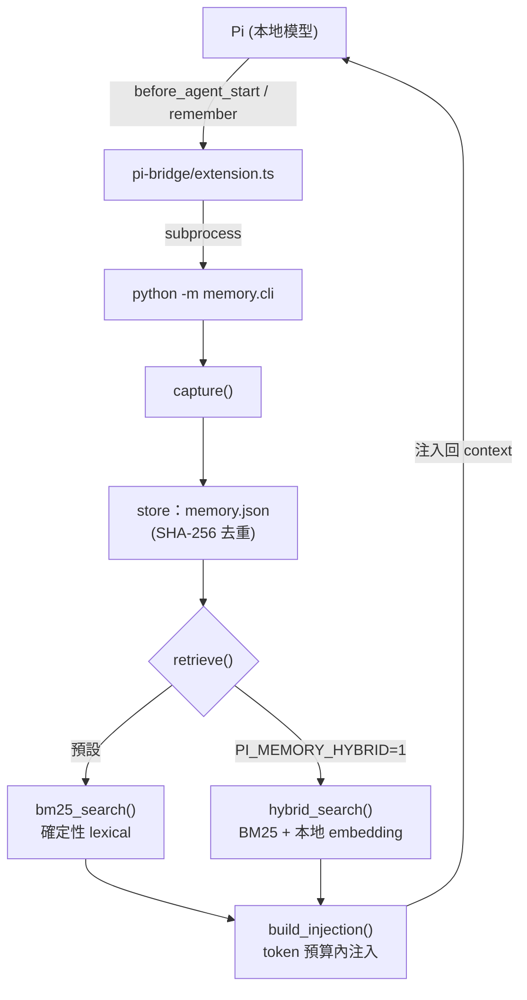

# AIASE2026 HW4 — Pi Memory（Python）

> 為本地 coding agent 做一個跨 session 的記憶機制：**capture → store → retrieve → inject**。
> 核心、benchmark、評分皆為 Python；Pi 端只用已寫好的薄 TS bridge。

---

## 1. 設計概述

agent 每次 session 結束就遺忘一切。本系統在 Pi 的 context window 之外加一層**持久記憶**：把互動觀察寫到硬碟，下次 session 依當前任務檢索最相關片段、在 token 預算內注入回 context。



| 模組 | 職責 | 狀態 |
|---|---|---|
| `memory/bm25.py` | `tokenize()` + 標準 **BM25** 排序（確定性核心） | 已實作 |
| `memory/store.py` | `JsonStore`：JSON 持久層，SHA-256 去重 | 已實作 |
| `memory/hybrid.py` | 任務二：**Hybrid retrieval**（BM25 + 本地 embedding） | 已實作 |
| `memory/privacy.py` | 任務二：**隱私過濾**（capture 前遮除密鑰） | 已實作 |
| `memory/core.py` | 串接 capture / retrieve / inject（env 切換 hybrid、套用 redact、`forget()`） | 已提供＋擴充 |
| `memory/cli.py` | 給 Pi bridge 的 CLI（任務二加 `recall` / `forget`） | 已提供＋擴充 |

**確定性 vs 機率性**：`bm25_search()`、`JsonStore`、注入預算截斷、任務二的 `privacy.redact()` 與 `forget()` 皆為確定性，可被單元測試客觀驗證；只有 hybrid 的 embedding 相似度用到模型。純 BM25 路徑**始終保留**，hybrid 僅以環境變數選擇性啟用。

## 2. 環境

- **Python**：3.10.12（開發版本；需 >= 3.10）
- **純核心依賴**：僅標準函式庫；測試需 `pytest`。
- **任務二依賴**：`sentence-transformers` 5.5.1 / `torch` 2.12.0 / `numpy` 2.2.6。
- **Embedding 模型**：`sentence-transformers/paraphrase-multilingual-MiniLM-L12-v2`（多語言中英）。首次執行自 Hugging Face 下載並快取於 `~/.cache/huggingface`，之後純**本地 CPU 推論、不呼叫雲端 API**。可用 `PI_MEMORY_EMBED_MODEL` 換模型。
- **Pi（僅 demo 需要）**：`@earendil-works/pi-coding-agent`（實測 0.74.2），需 **Node.js >= 20**（Pi 用到 regex `v` flag，Node 16/18 會以 `Invalid regular expression flags` 失敗）。
- **Demo 用 LLM / context size / 後端 / VRAM**：`qwen3:14b / 32768 ctx / Ollama on host (172.17.0.1) / 24GB VRAM (TITAN RTX)`。

## 3. 安裝與測試

```bash
python -m venv env && source env/bin/activate   # 建立虛擬環境
pip install -r requirements.txt
PYTHONPATH=. pytest -q                           # 17 passed（全綠）
```

> 只想驗純 BM25 核心：`pip install pytest` 即可（不需 sentence-transformers）。

## 4. 跑 Benchmark

```bash
# 純 BM25（預設）
PYTHONPATH=. python benchmark/run_benchmark.py --k 5 --per-query

# 大語料（100 筆 / 40 題，含同義詞與跨語言難題）
PYTHONPATH=. python benchmark/run_benchmark.py \
    --corpus corpus_large.jsonl --queries queries_large.jsonl --k 5 --per-query

# 任務二 Hybrid（env 開關；可選 PI_MEMORY_ALPHA 調權重，預設 0.2）
PYTHONPATH=. PI_MEMORY_HYBRID=1 python benchmark/run_benchmark.py \
    --corpus corpus_large.jsonl --queries queries_large.jsonl --k 5
```

實測（k=5）：

| 指標 | 基準語料 BM25→hybrid | 大語料 BM25→hybrid |
|---|---|---|
| Recall@5 | 0.810 → 1.000 | 0.838 → 0.988 |
| MRR | 0.810 → 0.976 | 0.826 → 0.958 |
| nDCG@5 | 0.802 → 0.982 | 0.795 → 0.953 |

純 BM25 接不到的同義詞（package manager↔pnpm、payment↔Stripe）與跨語言（英查中 / 中查英）題，hybrid 皆修好。完整錯誤分析見 `REPORT.md`。

## 5. 接到 Pi 執行 demo（cwd 與 PYTHONPATH）

bridge 透過 `python -m memory.cli` 呼叫本系統，**必須讓 Python 找得到 `memory/` 套件**。請在 repo 根目錄執行並設 `PYTHONPATH=.`：

```bash
cp models.json.example ~/.pi/agent/models.json   # 改成本地 model id
cd <此 repo 根目錄>
PYTHONPATH=. pi -e ./pi-bridge/extension.ts       # bridge 會呼叫 python -m memory.cli
```

需 **Node >= 20**（見 §2）。完整逐步腳本見 `demo/README.md`。

> 加掛 `pi-bridge/permission-gate.ts`，agent 跑每條 bash 前先問 Yes/No（避免本地小模型亂下指令；新增檔，不動原 bridge）：
> `PYTHONPATH=. pi -e ./pi-bridge/extension.ts -e ./pi-bridge/permission-gate.ts`

**本機實測（Ollama 後端）**：`~/.pi/agent/models.json` 的 `ollama` provider，`baseUrl` 指向本地 Ollama。
若 **pi 在容器內、Ollama 在主機**，`localhost` 不通，要改用 Docker bridge gateway（例如 `http://172.17.0.1:11434/v1`）：

```jsonc
{ "providers": { "ollama": {
  "baseUrl": "http://172.17.0.1:11434/v1", "api": "openai-completions", "apiKey": "ollama",
  "models": [ { "id": "qwen3:14b", "input": ["text"] } ]
} } }
```

> 若把 extension 複製到 `~/.pi/agent/extensions/` 自動載入，請改用絕對路徑或在啟動環境設好 `PYTHONPATH`，確保 bridge 仍能呼叫到 Python 記憶系統。
> hybrid 的優勢請用 §4 的 benchmark 客觀呈現；**不建議在 pi 的小記憶集即時展示 hybrid**（筆數少時 embedding 排序不穩，理由見 `demo/README.md`）。

## 6. 任務二（實作三項）

### 6.1 Hybrid Retrieval（BM25 + 本地 embedding）
- **獨立函式** `memory/hybrid.py::hybrid_search()`，**不動 `bm25_search()`**——純 BM25 維持標準、確定性，供公開／隱藏測試。
- 以環境變數啟用：`PI_MEMORY_HYBRID=1`（在 `core.retrieve()` 切換）；`PI_MEMORY_ALPHA` 調 lexical 權重。
- **融合**：候選集內 BM25 分數與 embedding cosine 相似度各自 min-max 正規化，`score = alpha*lexical + (1-alpha)*semantic`，`alpha=0.2`（benchmark 掃描而得）。文件向量以 (id+text) 快取。
- **效果**：大語料 Recall@5 0.838→0.988，修好純 BM25 的語義 / 跨語言天花板（見 §4、`REPORT.md`）。

### 6.2 隱私過濾 Privacy filter（`memory/privacy.py`）
- `redact()` 純函式、確定性，於 `core.make_observation()` 寫入前遮除 `sk-...`、`ghp_...`、`AKIA...`、`xox.-...`、`Bearer ...`、`password=`/`api_key=` 等密鑰，**連 SHA-256 id 也以遮罩後文字計算**，secrets 不以任何形式落到 `memory.json`。
- 有單元測試驗證（`tests/test_memory.py`）。

### 6.3 `/recall` 與 `/forget`（`memory/cli.py`）
```bash
PYTHONPATH=. python -m memory.cli recall  --query "how to run tests" --k 3   # 人類可讀列出相關記憶
PYTHONPATH=. python -m memory.cli forget  --query "docker"                   # 依子字串刪除
PYTHONPATH=. python -m memory.cli forget  --id <observation-id>              # 依 id 精確刪除
```
- `forget` 由 `core.forget()` + `JsonStore.delete()/delete_where()` 實作並 persist；有單元測試。這兩個指令以 CLI subcommand 形式提供，可在 demo 直接展示「取回 / 遺忘」。

## Demo

影片：Session A 教 agent 兩項慣例（英：用 pnpm／`pnpm test`；中：commit 用繁體中文＋先跑 `make lint`）→ `/quit` 關閉 → Session B 重開，用不同問題（「How do I run the tests?」「幫我把這次修改 commit 起來」）分別驗證，agent 透過注入各自「記得」對應慣例。完整腳本見 `demo/README.md`。

Demo 連結：`https://youtu.be/YbtzJhaWpM8`
